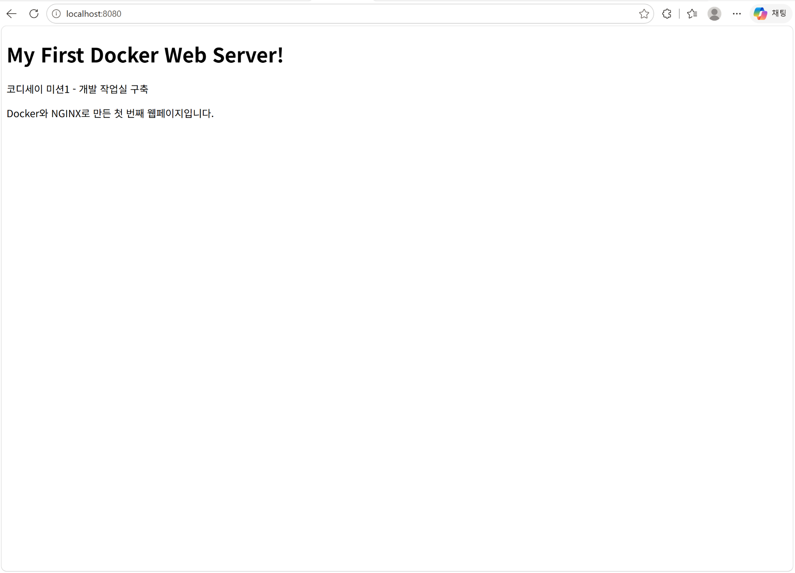
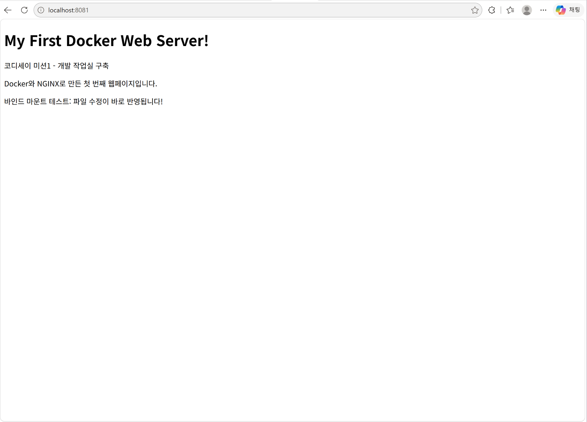
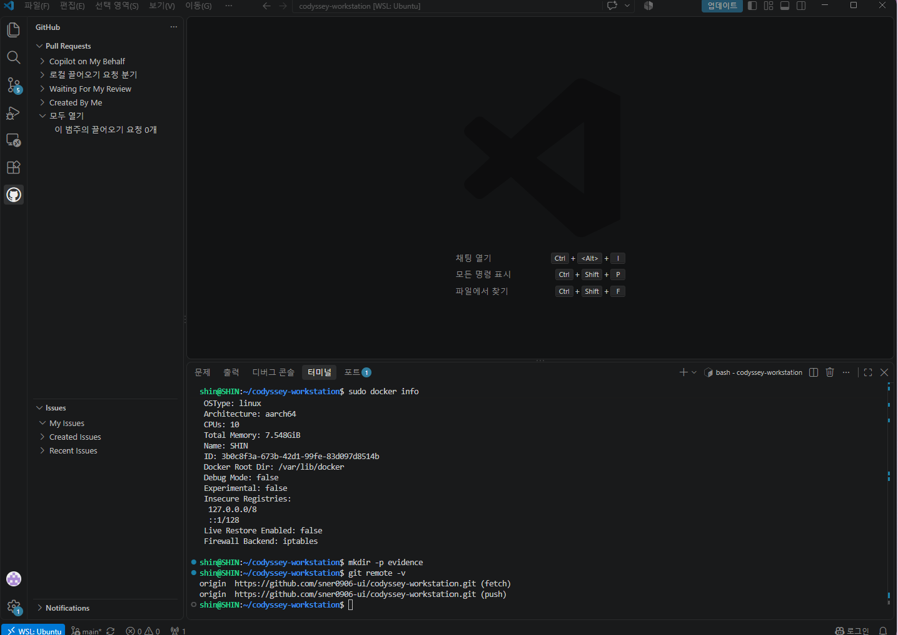

# 코디세이 입학연수 미션1 — 내 컴퓨터에 개발자용 작업실 꾸미기

Linux 터미널, Docker, Git/GitHub를 직접 설정하고, NGINX 웹 서버를 컨테이너로 실행한 실습 프로젝트입니다. 파일 권한 관리, 포트 매핑, 바인드 마운트, Docker 볼륨을 실습하고 명령어·출력·브라우저 화면으로 결과를 확인했습니다.

**GitHub 저장소:** https://github.com/sner0906-ui/codyssey-workstation

## 1. 수행 항목 체크리스트

- [x] Linux 터미널 기본 조작(현재 위치, 목록, 이동, 생성, 복사, 이름 변경, 삭제, 파일 내용 확인)
- [x] 파일과 디렉터리 권한 변경 및 확인
- [x] Docker 설치, 버전 및 실행 환경 점검
- [x] `hello-world` 실행, Ubuntu 컨테이너 진입과 관리
- [x] Dockerfile 직접 작성 및 커스텀 이미지 빌드
- [x] 8080번 포트로 NGINX 웹페이지 접속
- [x] 8081번 바인드 마운트의 변경 사항 반영
- [x] Docker 볼륨을 이용한 데이터 유지 확인
- [x] Git 설정, GitHub 업로드, VS Code에서 GitHub 로그인 및 저장소 연결
- [x] 실제 문제 해결 과정 2건 기록

체크 표시는 **실습 수행 기준**입니다. 원문이 요구하는 모든 터미널 출력의 원본을 보관한 것은 아니므로, 아래에서는 확인된 출력과 수행 사실을 구분해 기록했습니다.

## 2. 실행 환경과 프로젝트 구조

| 항목 | 사용 환경 |
|---|---|
| 노트북 OS | Windows 11 |
| Linux 환경 | WSL2, Ubuntu 26.04.1 LTS |
| 아키텍처 | ARM64 (`aarch64`) |
| 터미널·셸 | VS Code 통합 터미널, Ubuntu Bash |
| Docker | 29.1.3 (`docker.io` 패키지 설치) |
| 웹 서버 | NGINX (`nginx:alpine` 기반) |
| Git | 2.53.0 |
| GitHub 브랜치 | `main` |

```text
codyssey-workstation/
├── .gitignore
├── Dockerfile
├── README.md
├── evidence/
│   ├── 8080-web.png
│   ├── 8081-bind.png
│   └── github-vscode.png
├── site/
│   └── index.html
└── terminal-lab/
    ├── practice.txt
    └── moved-files/
        └── renamed-practice.txt
```

`evidence` 폴더의 세 이미지와 이 README를 함께 GitHub에 업로드했습니다. Windows에서 복사할 때 생긴 `Zone.Identifier` 및 임시 `.TMP` 파일은 `.gitignore`로 업로드 대상에서 제외했습니다.

## 3. Linux 터미널과 권한 실습

### 기본 명령어

실습에 사용한 명령어는 `pwd`(현재 위치), `ls -la`(숨김 파일 포함 목록), `mkdir`(폴더 생성), `cd`(이동), `touch`(빈 파일 생성), `echo`(문자 출력), `cat`(파일 내용 확인), `cp`(복사), `mv`(이동·이름 변경), `rm`(삭제), `chmod`(권한 변경)입니다.

현재 위치와 실습 폴더 목록을 재확인했습니다.

```bash
pwd && ls -la terminal-lab
```

확인한 출력 중 핵심 부분:

```text
/home/shin/codyssey-workstation
...
drwx------ 2 shin shin 4096 Oct 30 16:58 moved-files
-rw------- 1 shin shin   16 Oct 30 16:33 practice.txt
```

`terminal-lab/moved-files/renamed-practice.txt`는 이동·이름 변경 실습 후 남은 파일입니다. 최초 실습 때의 터미널 출력 전체는 별도로 보관하지 않았기 때문에, 파일 만들기·복사·이름 변경·삭제 과정은 아래와 같이 **임시 폴더에서 다시 실행해 검증**했습니다. 실제 프로젝트 파일은 변경하지 않았습니다.

```bash
mkdir -p /tmp/codyssey-cli-check && cd /tmp/codyssey-cli-check && touch original.txt && echo "Codyssey CLI test" > original.txt && cat original.txt && cp original.txt copy.txt && mv copy.txt renamed.txt && ls -la && rm renamed.txt && ls -la && cd ~/codyssey-workstation
```

실제 출력에서 핵심 부분을 발췌했습니다.

```text
Codyssey CLI test
# 첫 번째 ls -la: 원본과 이름을 바꾼 복사본을 확인
-rw-r--r-- 1 shin shin 18 Nov  3 00:19 original.txt
-rw-r--r-- 1 shin shin 18 Nov  3 00:19 renamed.txt
# 두 번째 ls -la: renamed.txt 삭제 후 원본만 남음
-rw-r--r-- 1 shin shin 18 Nov  3 00:19 original.txt
```

위 `#` 설명은 출력 이해를 돕기 위해 적은 문장입니다. `mkdir`(폴더 생성) → `cd`(폴더 이동) → `touch`(빈 파일 생성) → `echo`/`cat`(쓰기·읽기) → `cp`(복사) → `mv`(이름 변경) → `rm`(삭제) 순서로 실행했습니다. 마지막에 원래 프로젝트 폴더로 돌아왔습니다.

### 권한 변경 전후

| 대상 | 변경 전 | 변경 후 | 확인된 문자 표기 |
|---|---:|---:|---|
| `practice.txt` | 644 | **600** | `-rw-------` |
| `moved-files` | 755 | **700** | `drwx------` |

권한 변경 당시 사용한 명령어(해당 폴더 안에서 실행):

```bash
chmod 600 practice.txt
chmod 700 moved-files
```

프로젝트 최상위 폴더에서 다시 확인한 명령어:

```bash
ls -ld terminal-lab/practice.txt terminal-lab/moved-files
```

실제 출력:

```text
drwx------ 2 shin shin 4096 Oct 30 16:58 terminal-lab/moved-files
-rw------- 1 shin shin   16 Oct 30 16:33 terminal-lab/practice.txt
```

`r`은 읽기(4), `w`는 쓰기(2), `x`는 실행·디렉터리 접근(1)을 뜻합니다. `600`은 소유자만 읽고 쓸 수 있고, `700`은 소유자만 디렉터리에 접근할 수 있다는 뜻입니다. **절대 경로**는 `/home/shin/codyssey-workstation`처럼 위치를 처음부터 적고, **상대 경로**는 현재 폴더 기준 `terminal-lab/practice.txt`처럼 적습니다.

## 4. Docker 설치·점검 및 운영 결과

설치 및 버전 확인에 사용한 명령어:

```bash
sudo apt update
sudo apt install docker.io
docker --version
sudo docker info
```

버전 출력:

```text
Docker version 29.1.3, build 29.1.3-0ubuntu4.1
```

### Docker 실행 환경

```bash
sudo docker info
```

실제 출력 발췌:

```text
Client:
 Version: 29.1.3
Server:
 Containers: 4
  Running: 2
  Paused: 0
  Stopped: 2
 Images: 6
 Server Version: 29.1.3
 Storage Driver: overlayfs
 Logging Driver: json-file
 Operating System: Ubuntu 26.04.1 LTS
 Architecture: aarch64
```

### 이미지 목록

```bash
sudo docker images
```

실제 출력에서 주요 열 발췌:

```text
IMAGE                 DISK USAGE   CONTENT SIZE
codyssey-my-web:1.0   93.2MB       26.3MB
hello-world:latest    22.6kB       10.3kB
nginx:alpine          94.1MB       27.2MB
ubuntu:latest         181MB        44.9MB
```

### 컨테이너 상태

```bash
sudo docker ps -a
```

당시 출력에서 정리한 내용:

| 이름 | 이미지 | 당시 상태 | 호스트 포트 |
|---|---|---|---|
| `codyssey-bind` | `codyssey-my-web:1.0` | `Up 5 hours` | 8081 → 80 |
| `codyssey-web` | `codyssey-my-web:1.0` | `Up 5 hours` | 8080 → 80 |
| `ubuntu-lab` | `ubuntu` | `Exited (137)` | 없음 |
| `romantic_moore` | `hello-world` | `Exited (0)` | 없음 |

`Up`은 실행 중, `Exited`는 종료됨을 뜻합니다. `Exited (137)`의 정확한 종료 원인은 이 목록만으로 판단할 수 없습니다.

### 웹 서버 로그와 자원 사용량

```bash
sudo docker logs --tail 20 codyssey-web
```

실제 로그에서 발췌:

```text
[notice] nginx/1.31.8
"GET / HTTP/1.1" 200 384
"GET /favicon.ico HTTP/1.1" 404 555
"GET / HTTP/1.1" 304 0
```

`GET /`의 `200`은 홈페이지 접속 성공을 나타냅니다. `favicon.ico`의 `404`는 사이트 아이콘 파일이 없다는 뜻이며, 홈페이지 접속 실패를 의미하지는 않습니다.

```bash
sudo docker stats --no-stream codyssey-web
```

당시 측정된 값:

```text
NAME           CPU %   MEM USAGE / LIMIT      MEM %   PIDS
codyssey-web   0.00%   11.59MiB / 7.548GiB   0.15%   11
```

이 수치는 **측정 순간의 값**으로, 다시 실행하면 달라질 수 있습니다.

## 5. 기본 컨테이너 실습

### hello-world 및 Ubuntu

```bash
sudo docker run hello-world
sudo docker run -it --name ubuntu-lab ubuntu bash
```

`hello-world` 실행 성공 메시지를 확인했습니다. Ubuntu 컨테이너에 진입해 `ls`, `echo` 명령어를 실행하고 `exit`로 나왔습니다. 또한 `docker start`, `docker stop`, `docker ps`, `docker ps -a`, `docker exec`, `docker attach`를 실습했습니다. 다만 **당시 Ubuntu 컨테이너 안에서 실행한 `ls`/`echo`의 정확한 출력은 별도로 보관하지 않았습니다.**

`hello-world`를 다시 실행하여 성공 출력을 확인했습니다. `--rm`은 테스트가 끝난 임시 컨테이너를 자동으로 제거하는 옵션입니다.

```bash
sudo docker run --rm hello-world
```

실제 출력 발췌:

```text
Hello from Docker!
This message shows that your installation appears to be working correctly.
```

이 출력으로 Docker 클라이언트가 엔진에 연결하고 테스트 컨테이너를 정상 실행했음을 확인했습니다.

Ubuntu 이미지로 별도의 임시 컨테이너를 실행해 내부의 최상위 폴더 목록과 `echo` 출력을 재확인했습니다. `--rm`으로 실행 종료 후 임시 컨테이너가 자동 삭제됩니다.

```bash
sudo docker run --rm ubuntu:latest sh -c 'ls / && echo "Ubuntu container OK"'
```

실제 출력(전체 폴더 목록):

```text
bin
boot
dev
etc
home
lib
media
mnt
opt
proc
root
run
sbin
srv
sys
tmp
usr
var
Ubuntu container OK
```

이 결과는 **Ubuntu 컨테이너 내부에서 `ls`와 `echo`가 실행됨**을 보여줍니다. 최초 `ubuntu-lab` 대화형 접속 기록과는 별개의 재검증 결과입니다.

### `exec`와 `attach` 비교

| 명령어 | 하는 일 | `exit`의 영향 |
|---|---|---|
| `sudo docker exec -it ubuntu-lab bash` | 실행 중인 컨테이너에서 **새 Bash 프로세스** 실행 | 새 Bash가 종료되며, 주 프로세스가 살아 있다면 컨테이너는 계속 실행 |
| `sudo docker attach ubuntu-lab` | 컨테이너의 **기존 주 프로세스**에 연결 | 주 프로세스가 Bash라면 `exit`로 컨테이너가 종료될 수 있음 |

`attach` 연결만 해제할 때는 일반적으로 `Ctrl + P` 다음 `Ctrl + Q`를 사용할 수 있습니다. 위 두 명령은 대상 컨테이너가 **실행 중일 때** 사용합니다.

## 6. 커스텀 Docker 이미지 및 웹 서버

### Dockerfile

기존 베이스 이미지로 가벼운 `nginx:alpine`을 선택했습니다. 프로젝트 최상위 폴더의 `Dockerfile`을 직접 작성했습니다.

```dockerfile
FROM nginx:alpine
LABEL org.opencontainers.image.title="codyssey-my-web"
COPY site/ /usr/share/nginx/html/
EXPOSE 80
```

각 항목의 목적:

- `FROM`: 기존 NGINX 이미지를 기반으로 사용
- `LABEL`: 만든 이미지에 설명 정보 추가
- `COPY`: 직접 작성한 `site/index.html`을 웹 서버 폴더로 복사
- `EXPOSE 80`: 컨테이너 안에서 사용하는 웹 서버 포트를 표시 (`EXPOSE`만으로 외부 접속이 열리지는 않음)

### 빌드·실행 및 확인

프로젝트 최상위 폴더에서 실행했습니다.

```bash
sudo docker build -t codyssey-my-web:1.0 .
sudo docker run -d --name codyssey-web -p 8080:80 codyssey-my-web:1.0
```

빌드 결과 `codyssey-my-web:1.0`이 이미지 목록에 나타났고, 컨테이너 실행 후 Windows 브라우저에서 `http://localhost:8080`에 접속하여 **My First Docker Web Server!** 문구를 확인했습니다. 빌드 당시의 터미널 로그 원문은 별도로 보관하지 않았으므로 **이미지 목록·컨테이너 상태·브라우저 화면**을 결과 증거로 사용합니다.



**포트 매핑:** `-p 8080:80`은 노트북의 8080번 포트와 컨테이너 안의 80번 포트를 연결합니다. 이 설정 덕분에 브라우저에서 접속할 수 있습니다.

## 7. 바인드 마운트와 Docker 볼륨

### 바인드 마운트: 파일 변경 즉시 반영

```bash
sudo docker run -d --name codyssey-bind -p 8081:80 -v "$(pwd)/site:/usr/share/nginx/html:ro" codyssey-my-web:1.0
```

`$(pwd)/site`는 Ubuntu에서 직접 수정하는 폴더이고, `:ro`는 컨테이너에서 **읽기 전용**으로 연결한다는 뜻입니다. `site/index.html`에 다음 문장을 추가하고 **이미지를 다시 빌드하지 않은 상태**에서 두 페이지를 비교했습니다.

```text
바인드 마운트 테스트: 파일 수정이 바로 반영됩니다!
```

| 비교 대상 | 관찰한 결과 |
|---|---|
| `http://localhost:8080` | 이미지에 복사된 **기존 HTML** 표시 |
| `http://localhost:8081` | 수정한 HTML에 위 문장이 **추가되어 표시** |



위 8080·8081 사진에는 주소창과 응답 화면이 함께 포함되어 있습니다.

### 볼륨: 컨테이너 삭제 후에도 데이터 유지

```bash
sudo docker volume create codyssey-data
sudo docker volume ls
```

볼륨을 연결한 첫 임시 컨테이너에서 파일을 만들고 내용을 확인했습니다.

```bash
sudo docker run --rm -v codyssey-data:/data ubuntu:latest sh -c 'echo "Codyssey volume test" > /data/volume-test.txt && cat /data/volume-test.txt'
```

출력:

```text
Codyssey volume test
```

첫 컨테이너는 `--rm`으로 종료 후 삭제됩니다. **새로운 임시 컨테이너**에서 같은 볼륨의 파일을 읽었습니다.

```bash
sudo docker run --rm -v codyssey-data:/data ubuntu:latest cat /data/volume-test.txt
```

재확인한 실제 출력:

```text
Codyssey volume test
```

따라서 **컨테이너가 사라져도 볼륨의 데이터는 유지**됨을 확인했습니다.

## 8. Git·GitHub·VS Code 연동

Git은 내 컴퓨터의 파일 변경 이력을 관리하는 도구이고, GitHub는 해당 이력을 온라인 저장소에서 공유하는 서비스입니다.

프로젝트에서는 `main` 브랜치로 Git을 초기화하고, 작성자 정보를 설정한 다음 GitHub 공개 저장소에 커밋을 업로드했습니다.

```bash
git init -b main
git config --local user.name "Codyssey Learner"
# 이메일은 실제 GitHub noreply 주소로 설정했으며 여기에는 공개하지 않습니다.
git config --list
git remote -v
git status
```

`git config --list`의 실제 출력 중 **개인 이메일은 가려서** 발췌:

```text
user.name=Codyssey Learner
user.email=[GitHub noreply 이메일 마스킹]
remote.origin.url=https://github.com/sner0906-ui/codyssey-workstation.git
branch.main.remote=origin
branch.main.merge=refs/heads/main
```

저장소 연결 확인:

```bash
git remote -v
```

```text
origin  https://github.com/sner0906-ui/codyssey-workstation.git (fetch)
origin  https://github.com/sner0906-ui/codyssey-workstation.git (push)
```

VS Code를 **WSL: Ubuntu**에서 열어 GitHub에 로그인했고, 소스 제어에 `main` 브랜치와 커밋 기록이 나타나는 것을 확인했습니다.



이후 README·증빙 이미지·`.gitignore` 변경 사항을 커밋하고 `git push origin main`으로 업로드했습니다. 당시 `git status`에서는 `Your branch is up to date with 'origin/main'`과 `nothing to commit, working tree clean`을 확인했습니다. **이 상태는 이후 추가 편집 전의 기록**입니다.

## 9. 실제 오류와 해결 과정

### 사례 1. 커밋 작성자 정보 누락

- **문제:** 최초 `git commit` 때 Git 사용자 정보가 없어 실패했습니다.
- **원인 가설:** 커밋 작성자의 이름과 이메일이 설정되지 않았기 때문입니다.
- **확인:** 터미널의 사용자 정보 설정 안내 메시지를 확인했습니다.
- **해결:** `git config --local`로 프로젝트에 사용자 이름과 GitHub noreply 이메일을 설정했습니다.
- **결과:** 커밋과 GitHub 업로드에 성공했습니다.

### 사례 2. GitHub 인증 실패

- **문제:** 첫 `git push` 과정에서 `Invalid username or token` 오류가 나타났습니다.
- **원인 가설:** GitHub 사용자 이름 입력란과 개인 접근 토큰(PAT) 입력란을 혼동했습니다.
- **확인:** 인증 메시지를 읽고 입력 위치와 계정 정보를 점검했습니다.
- **해결:** 인증 정보를 올바른 위치에 입력했습니다. 노출된 이전 토큰은 즉시 폐기하고 새로 발급받아 연결 설정을 다시 진행했습니다.
- **결과:** `git push`에 성공했습니다. 실제 토큰·비밀번호·인증코드는 문서에 기록하지 않았습니다.

## 10. 재현 방법과 주의사항

다른 컴퓨터에서 동일한 웹페이지를 실행하려면 **Git, Docker와 실행 가능한 Docker 엔진**이 필요합니다. Windows에서는 WSL2 + Ubuntu에서 아래 명령을 실행한 환경을 기준으로 작성했습니다. 서울캠퍼스 공용 PC처럼 `sudo` 사용이 제한되는 환경은 **해당 환경의 공식 Docker 실행 안내**를 먼저 확인해야 합니다.

```bash
git clone https://github.com/sner0906-ui/codyssey-workstation.git
cd codyssey-workstation
sudo docker build -t codyssey-my-web:1.0 .
sudo docker run -d --name codyssey-web -p 8080:80 codyssey-my-web:1.0
```

브라우저에서 `http://localhost:8080`을 열어 확인합니다. **이미 같은 이름의 컨테이너가 있거나 8080번 포트가 사용 중이면** 컨테이너 이름 또는 호스트 포트를 변경해야 합니다. `sudo` 필요 여부는 운영 환경에 따라 다릅니다.

바인드 마운트의 `$(pwd)/site`는 **명령을 실행하는 폴더**에 따라 달라지므로, 반드시 프로젝트 최상위 폴더에서 실행해야 합니다. `codyssey-data`는 **해당 Docker 엔진 안의 볼륨**이므로 다른 PC에서 새로 만들어지며 기존 데이터가 자동으로 복사되지는 않습니다.

## 11. 배운 점

- Linux의 파일·폴더 관리와 권한 확인 방법을 익혔습니다.
- Dockerfile은 이미지를 만드는 설명서이고, 이미지는 컨테이너 실행에 필요한 파일과 설정을 담고 있다는 점을 이해했습니다.
- `-p`는 외부 포트 연결, 바인드 마운트는 호스트 파일 변경 반영, 볼륨은 컨테이너와 별개로 데이터를 저장하기 위해 사용한다는 차이를 확인했습니다.
- Git은 로컬 변경 기록, GitHub는 원격 공유·협업에 사용하는 도구라는 점을 배웠습니다.

### AI를 활용한 학습과 문서 정리

처음 배우는 Linux·Docker·Git 명령어의 뜻을 이해할 때 AI 설명을 참고했습니다. 명령어 입력, 프로그램 실행, 브라우저 접속, 출력 확인은 제 노트북에서 직접 진행했습니다. README의 순서와 표현을 정리할 때도 AI 도움을 받았습니다. **제가 확인하지 못한 실행 결과는 확인했다고 적지 않으려고 했습니다.**
